# 社团管理系统

一套面向学生社团的**成员、活动、经费**一体化管理系统。从活动立项审批到报名签到积分归档、
从会费收缴到预算执行率与财务公示，两个闭环都完整跑通，不是模块大拼盘。

全栈 TypeScript：Vue 3 + NestJS + Prisma + MySQL，前后端共享同一份枚举、权限码与类型定义。

> 个人练手项目。社团（星野天文社）、院系、成员与全部业务数据均为虚构，仅用于演示。


---

## 目录

- [功能概览](#功能概览)
- [界面](#界面)
- [技术栈](#技术栈)
- [几个设计上的取舍](#几个设计上的取舍)
- [项目结构](#项目结构)
- [快速开始](#快速开始)
- [演示账号](#演示账号)
- [常用命令](#常用命令)
- [设计原型与开发约定](#设计原型与开发约定)
- [已知范围](#已知范围)

---

## 功能概览

**组织与权限**

- 部门树、届次管理、成员档案与 Excel 批量导入导出
- RBAC 五张表：角色、权限、角色权限、成员角色
- **两层权限**：功能权限决定「能不能做」，数据范围决定「能看谁的数据」，两者缺一不可

**活动闭环**（从草稿到归档，每一步都留痕）

```
创建草稿 → 提交立项审批 → 部门负责人审批 → 社长审批 → 报名中
        → 报名（名额上限加锁校验）→ 审核报名 → 现场扫码/口令签到
        → 标记缺勤 → 发放积分（幂等）→ 填写总结 → 归档（只读）
```

- 审批走通用引擎，支持顺序节点、或签/会签、超时动作（提醒 / 自动通过 / 自动驳回 / 转交）
- 签到口令按**服务端时间片**计算，手机时钟不准不会导致签到失败；同时给出 6 位数字口令供人工播报
- 请假申请与审批、志愿时长登记、活动相册与总结归档

**经费闭环**

- 经费账户、科目树、收支流水、凭证上传
- **余额不落库**，永远由 `SUM(收入) - SUM(支出)` 算出；流水**只能作废不能删除**，作废必须写原因
- 预算申请与执行率（由该科目下已入账支出实时算出）
- 会费标准 → 生成应缴名单 → 登记缴费时**自动派生一笔收入流水**（同一事务）→ 欠费统计与催缴
- 财务公示页 + `POST /api/admin/reconcile` 对账接口，缓存字段全部可按流水重算

**日常运营**

- 站内信通知（公告发布自动推送给全体在册成员）
- 公告管理（发布 / 下架，重复发布不会重复推送）
- 值班表：排班 → 本人确认 → 写日志自动置「已完成」并记实际时长
- 物资借还与场地预约：物资可借数由借还记录驱动；场地时段冲突按**区间重叠**判定并在事务内加锁

**数据看板**

- 成员增长、活动状态分布、部门构成、积分排行
- 经费总览：余额、本月收支、科目构成、近 6 个月趋势

---

## 界面

### 工作台

指标行的每个数字都来自实时查询，图表由 ECharts 渲染，配色取自 CSS 设计令牌。

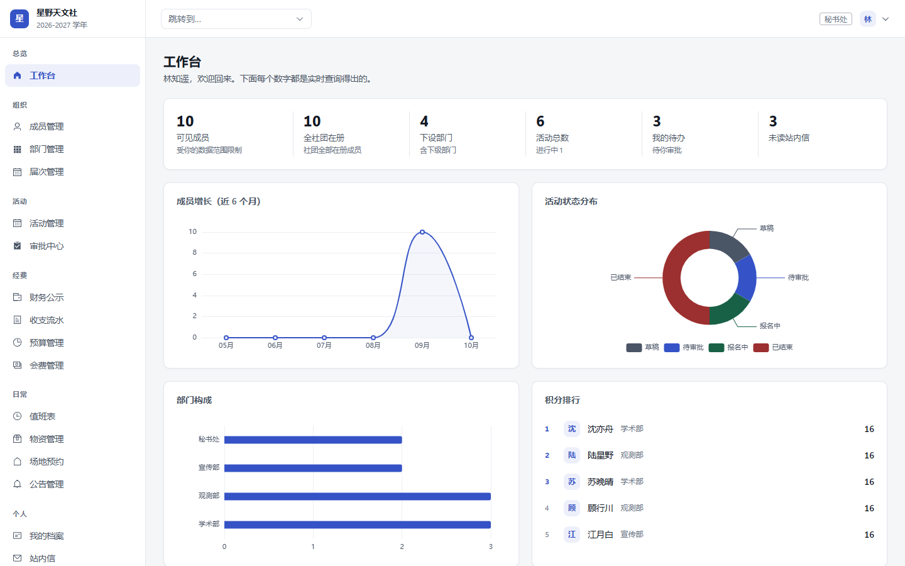

### 活动管理

一张卡片就是一场活动的完整状态：报名进度、待审人数、签到方式。

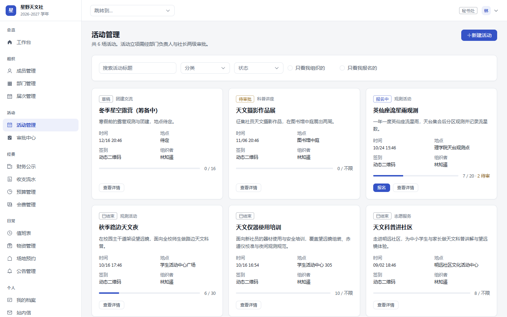

### 活动详情与签到记录

活动已归档，报名、签到、积分都有记录。这里能看到报名与签到的差异（1 人请假未到，标为缺勤）。

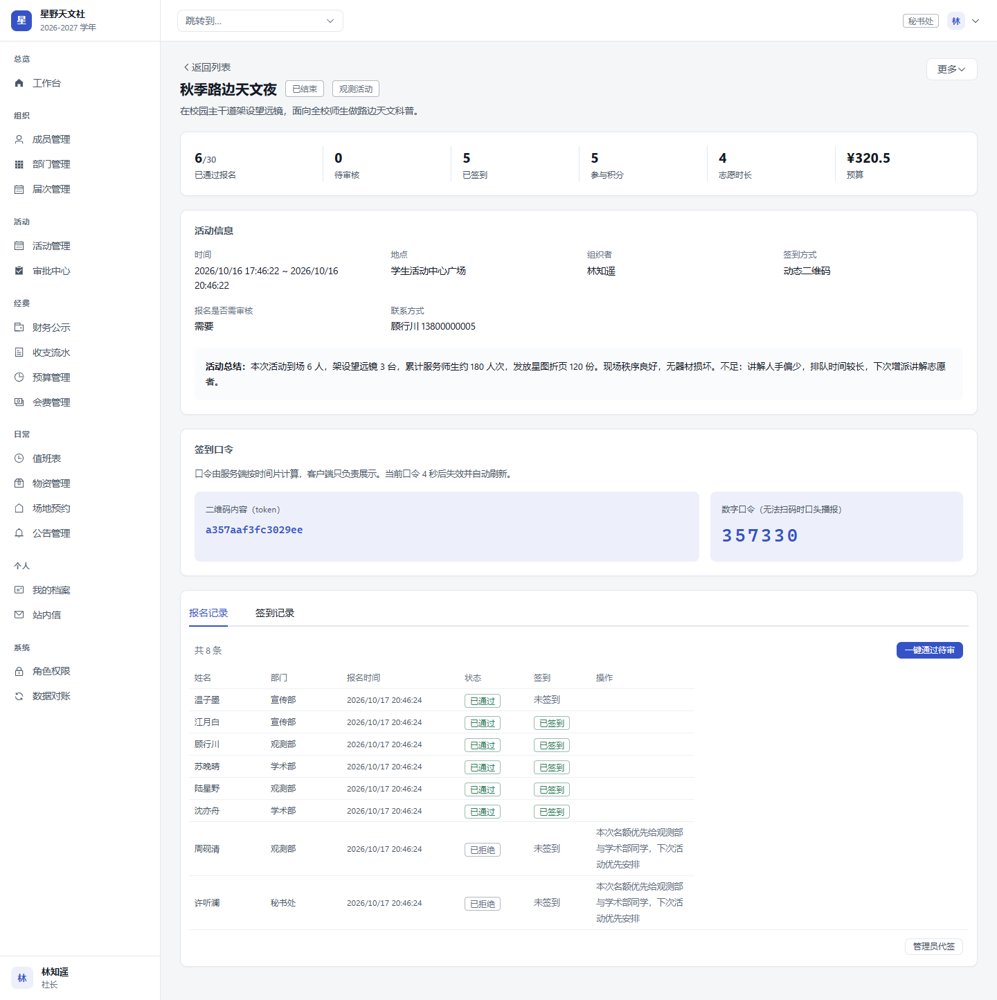 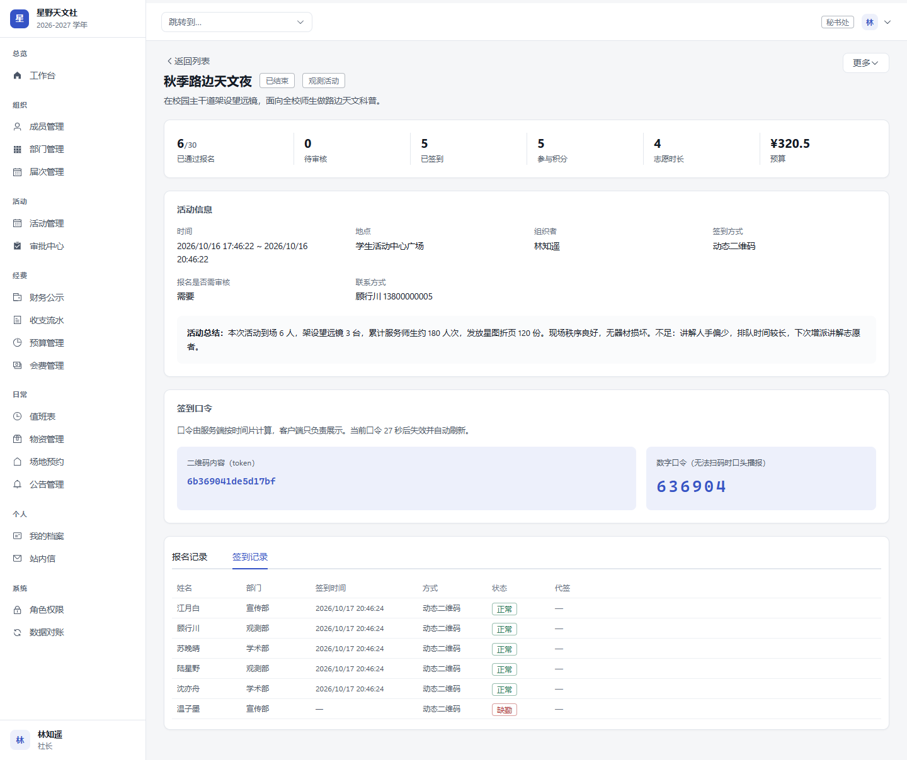

### 审批中心

活动立项、经费收支、预算申请共用同一套审批引擎，业务模块不轮询状态。

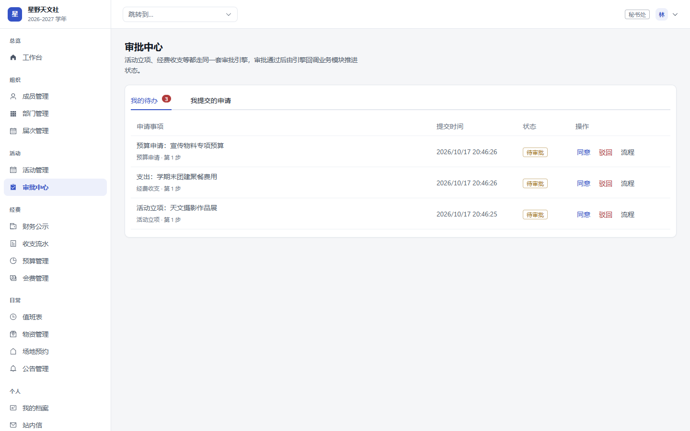

### 财务公示与收支流水

余额由流水算出。流水列表里那笔「已作废」的场地租金仍在库中可查，并记着作废原因——审计链不会断。

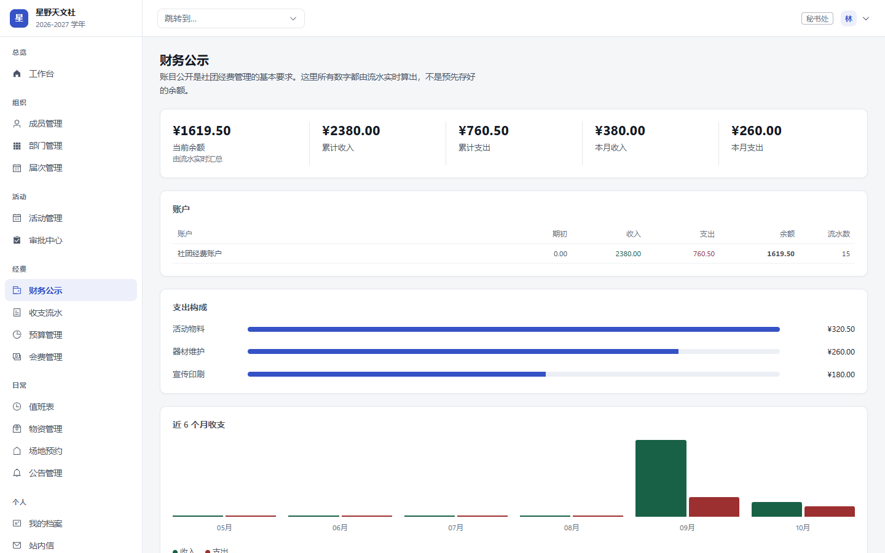 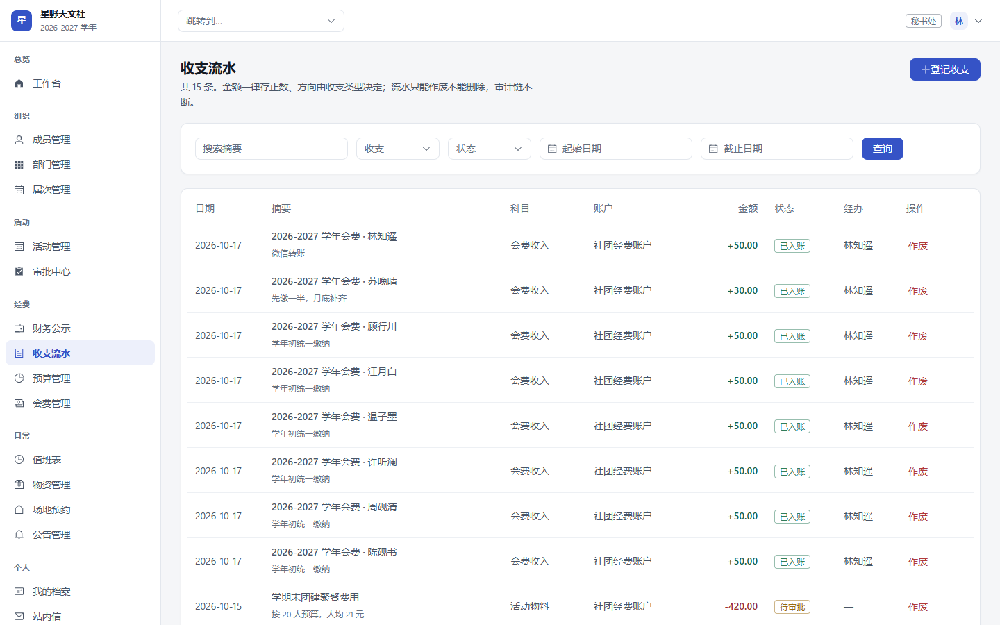

### 会费与预算

会费列表里能同时看到已缴清、部分缴纳、减免与欠费四种状态；预算执行率由已入账支出实时算出。

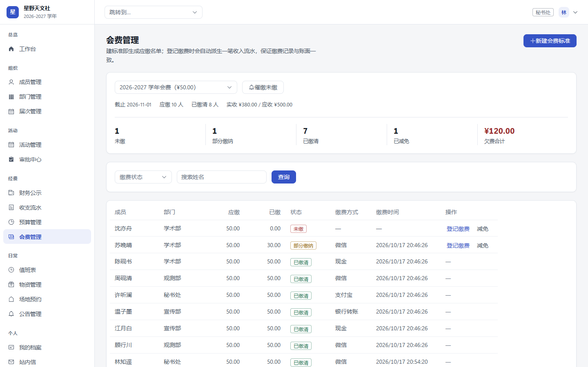 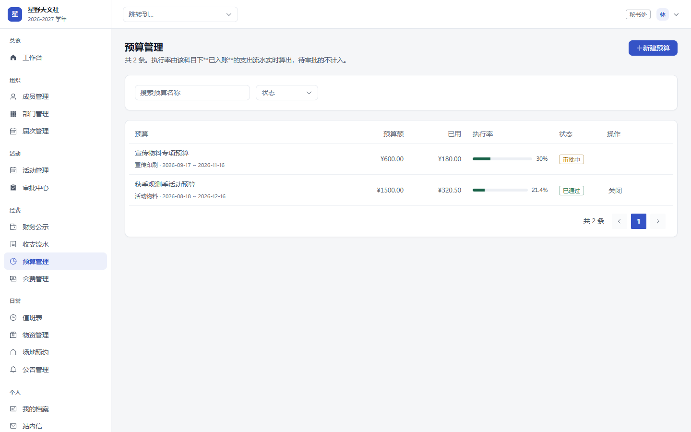

### 角色权限

两层权限一眼可见：右列是数据范围，权限数从社长 140 条到普通成员 19 条逐级收敛。

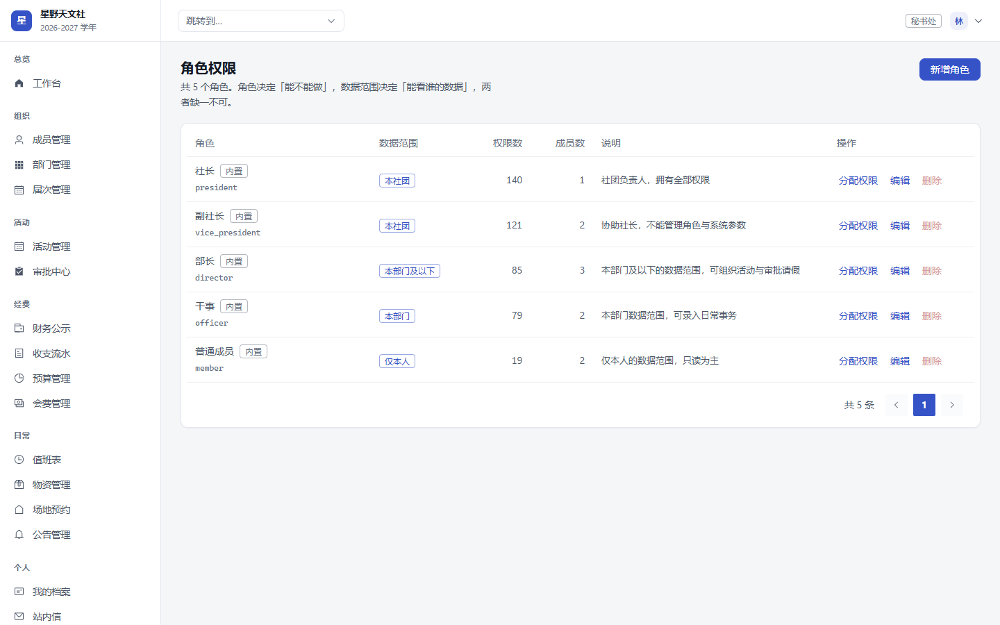

### 数据对账

缓存字段随时可以按流水重算，这里是财务类系统不可退让的底线。

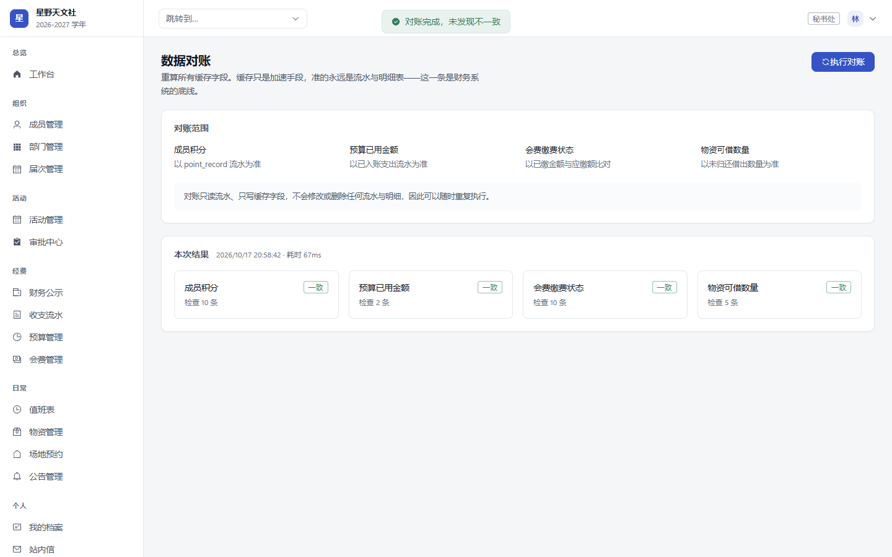

更多截图（成员、部门、届次、值班、物资、场地、公告、站内信、我的档案）在
[`docs/screenshots/`](docs/screenshots/)。

---

## 技术栈

| 层 | 选型 |
|---|---|
| 前端 | Vue 3.5 · TypeScript · Vite 8 · Pinia · Vue Router · Element Plus 2.14 · ECharts 6 · GSAP 3.15 |
| 后端 | NestJS 12 · Prisma 7（driver adapter）· Passport-JWT · class-validator · Swagger · ExcelJS |
| 数据库 | MySQL 8.0（utf8mb4 / utf8mb4_0900_ai_ci），62 张业务表 |
| 缓存 | Redis（验证码、登录限流、签到口令等） |
| 文件 | 本地磁盘（Multer），扩展名与 MIME 双白名单、MD5 秒传，预留对象存储切换字段 |
| 部署 | Vite 产物由 NestJS 静态托管，单进程一个端口；需要守护进程用 pm2 |

**为什么不用别的**（避免反复讨论）：本机没有 Docker、只有 JDK 8（Spring Boot 3 需要 17+），
Java/Docker 栈要先装环境；PostgreSQL 技术上更强，但国内评委与云服务器默认 MySQL；
FastAPI 写起来更快，代价是失去全栈类型共享。

---

## 几个设计上的取舍

这几条是全项目最费斟酌的地方，也是代码里注释写得最多的部分。

**1. 权限必须做两层。** 只做功能权限是最常见的越权来源：一个「能看成员列表」的干事，
如果不加数据范围，就能看到全社团的成员。所以 `role_permission` 管「能不能做」，
`role.dataScope`（仅本人 / 本部门 / 本部门及以下 / 本社团 / 全部，多角色取并集）管「能看谁的数据」，
每个查询都过一遍 `buildScopeWhere`，**导出接口同样要过**——那是最容易被忽略的越权入口。

**2. 聚合数字一律由流水算出。** 余额、积分、票数、预算已用金额、物资可借数都有缓存字段，
但准的永远是流水与明细表。为此专门做了 `POST /api/admin/reconcile`，把缓存按流水重建。
财务流水**绝不删除**，只能改 `status = 3` 并记录作废原因。

**3. 并发靠数据库兜底，不靠应用层「先查再插」。** 重复报名、重复签到、重复投票、
一人一届一次考核都用唯一索引兜住；报名超额与场地时段冲突这两类唯一索引覆盖不到，
在事务内 `SELECT ... FOR UPDATE` 锁行串行化。

**4. 审批是横切能力，不是活动的附属功能。** 活动立项、经费收支、预算申请共用同一套引擎
（四张表 + 节点配置）。业务模块只做两件事：提交审批、实现 `ApprovableHandler` 回调接口。
处理器由 NestJS 的 `DiscoveryService` 自动收集并按 `bizType` 注册，**业务侧不轮询审批状态**。

**5. 软删除用 `deletedAt BigInt @default(0)`，不用可空时间戳。**
MySQL 唯一索引不比较 `NULL`，若 `deletedAt` 允许为 NULL，
`UNIQUE(club_id, user_id, term_id, deleted_at)` 在多次删除后会因多行 NULL 而失效。

**6. 签到口令由服务端时间片算出。** 客户端只负责展示，因此手机时钟偏差、
或刚好跨过时间片边界都不会让签到莫名失败（校验时同时接受当前与上一个时间片）。

**7. 全仓库 ESM。** NestJS 12 官方包已是 ESM-only，因此相对导入必须带 `.js` 扩展名、
没有 `__dirname`。这是动手改代码时最容易踩的一条。

---

## 项目结构

```
club-management/
├── apps/
│   ├── server/                 NestJS 后端
│   │   └── src/
│   │       ├── common/         跨模块基础设施
│   │       │   ├── guards/     JwtAuthGuard、PermissionGuard
│   │       │   ├── decorators/ @CurrentMember @RequirePerm @Public
│   │       │   ├── filters/    全局异常过滤器（P2002 映射为 409 可读提示）
│   │       │   ├── interceptors/ 统一响应体 { code, message, data, traceId }
│   │       │   └── prisma/     PrismaService、软删除扩展、数据范围构建
│   │       └── modules/        认证、审批引擎、活动、经费、成员、值班、物资、场地…
│   └── web/                    Vue 3 前端
│       └── src/
│           ├── styles/         tokens.css 设计令牌（唯一颜色来源）+ Element Plus 主题覆盖
│           ├── api/ stores/ composables/ directives/ layouts/ views/
├── packages/
│   └── shared/                 前后端共享：枚举 + 中文标签、140 条权限码、错误码、DTO
├── prisma/
│   ├── schema.prisma           62 张表
│   ├── migrations/             版本化迁移
│   └── seed.ts                 种子数据（社团、届次、部门、角色权限、成员、科目、流程）
├── design/                     视觉方案原型（三个方向的完整 HTML 原型，方向 A 被采纳）
└── docs/
    └── screenshots/            界面截图（README 使用）
```

---

## 快速开始

**环境要求**：Node.js ≥ 20.19、MySQL 8.0、Redis。不需要 Docker。

```bash
# 1. 建库（字符集必须是 utf8mb4）
mysql -u root -p -e "CREATE DATABASE club_management DEFAULT CHARACTER SET utf8mb4 COLLATE utf8mb4_0900_ai_ci;"

# 2. 配置环境变量，把 PASSWORD 换成你本机 MySQL 的密码
cp .env.example .env

# 3. 装依赖（npm workspaces，一次装三个包）
npm install

# 4. 建表并灌种子数据
npm run db:deploy
npm run db:seed

# 5. 起服务
npm run dev:server     # 后端 http://127.0.0.1:3000 ，接口文档 /api/docs
npm run dev:web        # 前端 http://localhost:5173
```

打开 `http://localhost:5173`，用下面的演示账号登录。

> Prisma 7 起 `url` 不再写在 `schema.prisma` 里：迁移命令读仓库根目录的 `prisma.config.ts`，
> 运行时由 `PrismaClient` 的 driver adapter 提供连接。`.env` 的位置不变。

---

## 演示账号

种子数据里的 10 个账号密码都是 `Xingye@2026`，覆盖全部五档数据范围：

| 学号 | 姓名 | 部门 | 角色 | 数据范围 | 权限数 |
|---|---|---|---|---|---|
| `2024100101` | 林知遥 | 秘书处 | 社长 | 本社团 | 140 |
| `2024100102` | 沈亦舟 | 学术部 | 副社长 | 本社团 | 121 |
| `2024100103` | 陆星野 | 观测部 | 副社长 | 本社团 | 121 |
| `2024100104` | 苏晚晴 | 学术部 | 部长 | 本部门及以下 | 85 |
| `2024100105` | 顾行川 | 观测部 | 部长 | 本部门及以下 | 85 |
| `2025100106` | 江月白 | 宣传部 | 部长 | 本部门及以下 | 85 |
| `2025100107` | 温子墨 | 宣传部 | 干事 | 本部门 | 79 |
| `2025100108` | 许听澜 | 秘书处 | 干事 | 本部门 | 79 |
| `2025100109` | 周砚清 | 观测部 | 普通成员 | 仅本人 | 19 |
| `2025100110` | 陈砚书 | 学术部 | 普通成员 | 仅本人 | 19 |

**想直观感受两层权限**：用 `2024100101`（社长）和 `2025100109`（普通成员）分别登录，
同一份成员列表看到的数据范围不同，无权限的菜单与按钮直接不可见，绕过前端直接调接口会返回 403。

经后台表单或 Excel 导入新建的成员，初始密码来自系统参数 `member.initPassword`，默认 `Xy@123456`。

---

## 常用命令

```bash
npm run dev:server / dev:web    # 起后端 / 前端
npm run build                   # 依次构建 shared → server → web
npm run typecheck               # 全仓库类型检查

npm run prisma:validate         # 改完 schema 先跑这个
npm run db:migrate -- --name x  # 生成迁移并应用（开发环境）
npm run db:deploy               # 应用已有迁移（部署环境）
npm run db:seed                 # 灌种子数据（幂等，可反复执行）
npm run db:studio               # 可视化看数据
```

跑起来之后，想亲手走一遍完整闭环的话：用社长账号建一场活动 → 提交立项 → 在审批中心同意 →
换普通成员账号报名 → 回到社长账号审核 → 用活动详情页的签到口令签到 → 发放积分 → 归档。

---

## 设计原型与开发约定

视觉方案的原型可以直接双击打开，不需要启动服务，也不联网：

| 文件 | 内容 |
|---|---|
| [`design/README.md`](design/README.md) | 三套视觉方向的对比与选型理由，方向 A 的 tokens 映射 |
| `design/direction-a.html` | 方向 A（静默墨蓝）的完整高保真原型，全站采用的方案 |
| `design/index.html` | 三个方向的对比总览 |

原型里的登录校验、骨架屏、空状态、筛选，以及「降低动态偏好」都是可真实触发的，不是静态贴图。

动手改代码之前，有三条不可违背的红线，违反会导致返工：

1. 业务代码里不出现颜色字面值，一律走 CSS 变量（评审时可以一条 `grep` 验空）
2. 每个查询都必须带租户与数据范围过滤，不能只靠前端隐藏
3. 聚合数字一律由流水算出，缓存字段必须能重算

---

## 已知范围

项目定位是个人练手，按「将来能服务多个社团」设计，但**演示数据只覆盖一个社团**。
明确不做：出入校门禁等与社团无关的校园系统、即时聊天（通知只走站内信）、
在线支付（会费只记已缴/未缴与凭证）、原生 App 与小程序。

`club_id` 保留在每张业务表上作为多租户预留，`NotifyChannel` 里邮件与机器人的枚举值也保留着。
