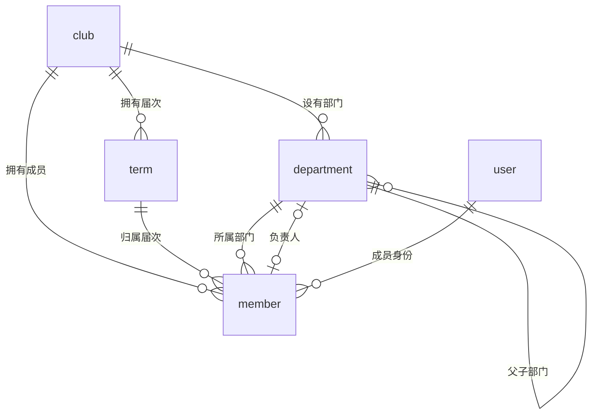
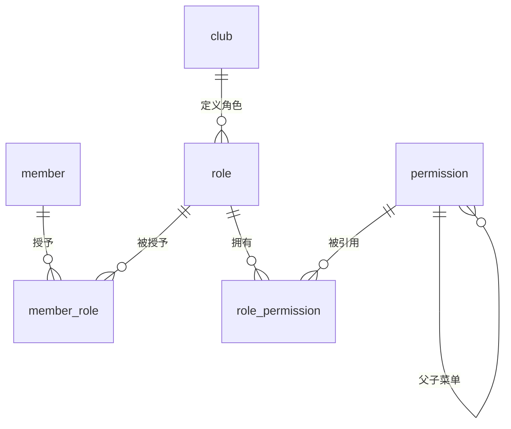
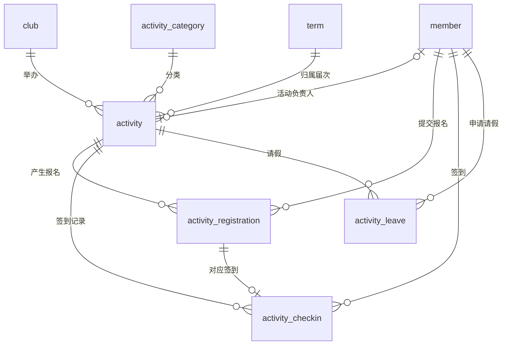
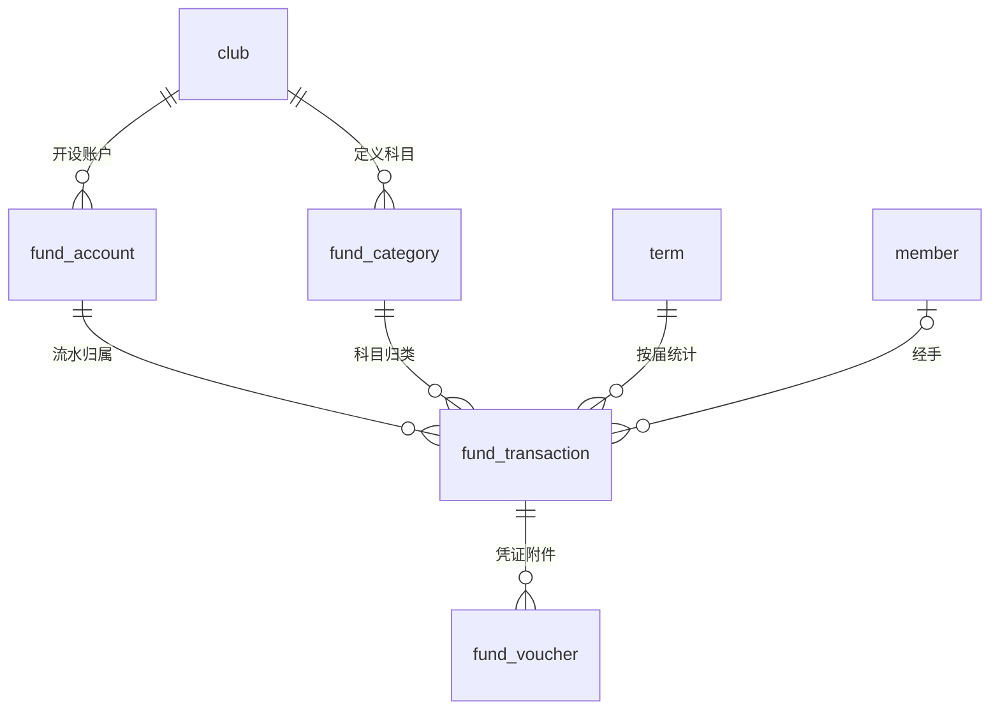
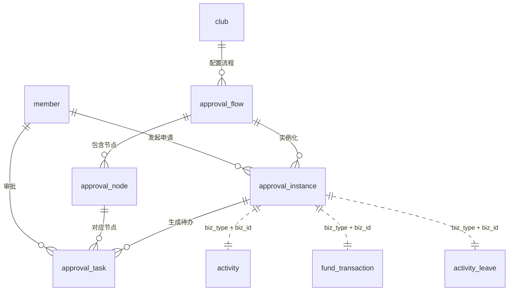

# 社团管理系统 · 数据库设计

> 版本：v1.0（2026-10-15）
> 目标数据库：MySQL 8.0.35
> 字符集：`utf8mb4` / `utf8mb4_0900_ai_ci`，存储引擎 `InnoDB`
> ORM：Prisma

---

## 目录

1. [设计约定](#1-设计约定)
2. [核心关系主线](#2-核心关系主线)
3. [分层建设计划](#3-分层建设计划)
4. [P0 地基与核心闭环表](#4-p0-地基与核心闭环表)
5. [P1 完善模块表](#5-p1-完善模块表)
6. [P2 亮点模块表](#6-p2-亮点模块表)
7. [枚举值附录](#7-枚举值附录)
8. [关键设计决策与坑](#8-关键设计决策与坑)
9. [典型业务链路](#9-典型业务链路)

---

## 1. 设计约定

### 1.1 字段命名

| 约定 | 说明 |
|---|---|
| 表名 | 小写下划线，单数（`activity_registration`） |
| 主键 | 一律 `id BIGINT UNSIGNED AUTO_INCREMENT` |
| 外键 | `xxx_id`，与被引用表主键同名 |
| 金额 | 一律 `DECIMAL(12,2)`，**禁止用 FLOAT/DOUBLE** |
| 布尔 | `TINYINT(1)`，命名 `is_xxx` |
| 状态 | `TINYINT`，命名 `status`，取值见附录 |
| 时间 | `DATETIME(3)`（与 Prisma 的 DateTime 对齐） |
| 排序 | `sort INT`，越小越靠前 |
| JSON | `JSON` 类型，命名 `xxx_json` |

### 1.2 公共字段

除纯关联表（如 `member_role`）外，所有业务表都带这几列：

```
created_at    DATETIME(3)      NOT NULL DEFAULT CURRENT_TIMESTAMP(3)
updated_at    DATETIME(3)      NOT NULL DEFAULT CURRENT_TIMESTAMP(3) ON UPDATE CURRENT_TIMESTAMP(3)
created_by    BIGINT UNSIGNED  NULL          -- 操作人 user_id
updated_by    BIGINT UNSIGNED  NULL
deleted_at    BIGINT UNSIGNED  NOT NULL DEFAULT 0   -- 0 表示未删除，否则存删除时间戳
```

**为什么 `deleted_at` 用 `0` 而不是 `NULL`**——这是个必须提前定的坑。MySQL 的唯一索引里 `NULL` 不参与比较，如果软删除字段是 `NULL`，那么 `UNIQUE(club_id, user_id, deleted_at)` 在多次删除后会产生多行 `NULL` 从而失效。把删除时间戳写成 `0` 或毫秒时间戳，唯一索引就能正常工作，"删掉再加入"也不会撞唯一键。

### 1.3 多社团预留（`club_id`）

**建议：所有业务表都带 `club_id`，即使现在只服务一个社团。**

理由：单社团跑的时候它只是个恒为 1 的字段，几乎没有成本；但如果后期想扩成"校社团联合会管多个社团"（我上一轮建议的亮点功能），没有它就得改所有表和所有查询，代价极高。有了它，加个 `WHERE club_id = ?` 就能隔离数据，配合数据范围权限即可实现多租户。

`user` 表**不带** `club_id`（人是跨社团的全局实体），社团归属由 `member` 表承载。

### 1.4 关联表命名

一律 `a_b` 形式，如 `member_role`、`role_permission`。这类表只保留两个外键 + 少量附加字段，且**不设自增主键**（用联合主键或独立 id 均可，推荐独立 `id` 便于 Prisma 操作）。

### 1.5 外键策略

| 表类型 | 物理外键 | 理由 |
|---|---|---|
| 核心业务表（member、activity、fund_transaction 等） | ✅ 建 | 数据完整性有保障，答辩时是加分项 |
| 日志/流水/关联表（operation_log、login_log、point_record） | ❌ 只建索引 | 写入量大、容忍弱关联，避免锁竞争 |

### 1.6 索引原则

- 所有外键列建普通索引（MySQL 不自动为外键建索引以外的列）
- 高频查询组合建复合索引，顺序遵循"等值在前、范围在后"
- 唯一约束优先于应用层校验（`UNIQUE` 兜底并发）
- 软删除表可在复合索引末尾加 `deleted_at`，或改用部分索引思路

---

## 2. 核心关系主线

整个系统可以理解为 **五条主线**，其他表都是挂靠在这五条线上的扩展：

```
                         ┌──────────┐
                         │   club   │  社团（多租户边界）
                         └────┬─────┘
        ┌──────────────┬──────┼──────────┬──────────────┐
        ▼              ▼      ▼          ▼              ▼
   ┌────────┐    ┌─────────┐ ┌────────┐ ┌────────┐  ┌─────────┐
   │ term   │    │department│ │  role  │ │activity│  │  fund_  │
   │ 届次   │    │  部门    │ │ 角色   │ │ 活动   │  │ account │
   └───┬────┘    └────┬────┘ └───┬────┘ └───┬────┘  └────┬────┘
       │              │          │          │            │
       └──────┬───────┴──────────┘          │            │
              ▼                             ▼            ▼
         ┌─────────┐                  ┌───────────┐ ┌──────────────┐
         │ member  │◄─────────────────│registration│ │fund_transaction│
         │ 成员档案│◄─── 报名/签到/请假/值班/积分/会费 ──│   经费流水   │
         └────┬────┘                  └───────────┘ └──────────────┘
              │
              ▼
        ┌─────────┐
        │  user   │  账号（登录凭证）
        └─────────┘
```

**关键分离：`user` 与 `member` 是两个实体。**

- `user` = 一个**人**的账号（学号、密码、手机号）——跨社团唯一
- `member` = 这个人**在某个社团里的成员身份**（届次、部门、职位、在册状态）

这个分离是整套设计的支点：它让"一个人同时属于两个社团""毕业退会后档案仍保留""每年换届产生新一届成员记录"三件事都能自然表达。如果合成一张表，这三件事都会变成打补丁。

**第二条支点：审批流是横切能力。** 活动立项、经费支出、预算、请假、场地、换班、入会都要审批。所以审批表通过 `biz_type + biz_id` 挂接任意业务，而不是每个模块各写一套。

### 2.1 ER 图（P0 核心）

下面按领域拆成 5 张 ER 图。字段细节见第 4 节，这里只表达关系与基数。

**① 组织架构与人员**



> `user` 1 对 N `member`——一个人可以在多个社团、多个届次都有成员身份，这是整套设计的支点。

**② 权限（RBAC + 数据范围）**



> 注意 `member_role` 关联的是 `member` 而非 `user`：角色是"在某社团里的角色"。

**③ 活动闭环**



> 报名、签到、请假是三条**平行**的记录，不合并。因为"已报名 + 已请假"是合法状态组合。

**④ 经费**



> 账户**不存余额字段**，余额由流水 SUM 得出，保证永不出现"账实不符"。

**⑤ 审批流（横切）**



> 虚线是**多态关联**（`biz_type` + `biz_id`），不是物理外键。这是审批流能同时服务活动、经费、请假等多个业务的原因，也是它不必随业务表增加而改造的原因。

---

## 3. 分层建设计划

| 层 | 表数 | 内容 | 对应阶段 |
|---|---|---|---|
| **P0** | 26 | 社团/届次/部门、用户与成员、RBAC 权限、字典、活动闭环（报名/签到/请假）、经费流水、审批流、审计日志 | 阶段 0–2（地基 + MVP） |
| **P1** | 23 | 公告通知、文件共享、物资场地、值班、预算报销、会费、积分 | 阶段 3（完善） |
| **P2** | 13 | 考核、志愿时长、招新、面试、投票、相册荣誉 | 阶段 4（亮点） |
| **合计** | **62** | | |

**建表顺序建议**（有外键依赖，必须从被引用的表开始建）：

```
club → term/department/role/permission → user → member → member_role/role_permission
  → sys_dict/sys_dict_item → approval_flow/approval_node
  → activity → activity_registration → activity_checkin/activity_leave
  → fund_account/fund_category → fund_transaction
```

---

## 4. P0 地基与核心闭环表

### 4.1 社团与组织架构

#### `club` 社团

| 字段 | 类型 | 说明 |
|---|---|---|
| id | BIGINT UNSIGNED | PK |
| code | VARCHAR(32) | 社团编号，UNIQUE |
| name | VARCHAR(64) | 社团名称，如"计算机协会" |
| short_name | VARCHAR(32) | 简称 |
| logo_url | VARCHAR(255) | 徽标 |
| cover_url | VARCHAR(255) | 封面图 |
| description | TEXT | 社团简介 |
| school_name | VARCHAR(64) | 所属学校 |
| college_name | VARCHAR(64) | 挂靠学院 |
| founded_at | DATE | 成立日期 |
| contact_email | VARCHAR(64) | 联系邮箱 |
| contact_phone | VARCHAR(20) | 联系电话 |
| advisor_name | VARCHAR(32) | 指导老师 |
| max_members | INT | 成员上限，0 = 不限 |
| status | TINYINT | 1 正常 / 2 停用 |
| + 公共字段 | | |

#### `term` 届次 / 学年

社团每年换届，成员必须归属某个届次，否则第二年数据就混了。

| 字段 | 类型 | 说明 |
|---|---|---|
| id | BIGINT UNSIGNED | PK |
| club_id | BIGINT UNSIGNED | FK → club |
| name | VARCHAR(32) | 如"2025-2026 学年" / "第 26 届" |
| start_date | DATE | 起始 |
| end_date | DATE | 结束 |
| is_current | TINYINT(1) | 是否当前届次（每社团仅一个为 1） |
| status | TINYINT | 1 进行中 / 2 已归档 |
| + 公共字段 | | UNIQUE(club_id, name) |

#### `department` 部门

支持树形（部门下可挂小组），`parent_id IS NULL` 表示顶级部门。
（原设计写「`parent_id = 0` 表示顶级」，落地时改为可空：`parent_id` 上有真实外键，
`0` 不存在对应行会被 MySQL 拒绝，见开发文档 6.1 节。）

| 字段 | 类型 | 说明 |
|---|---|---|
| id | BIGINT UNSIGNED | PK |
| club_id | BIGINT UNSIGNED | FK → club |
| parent_id | BIGINT UNSIGNED NULL | 上级部门，NULL = 顶级 |
| name | VARCHAR(32) | 如"技术部""宣传部" |
| leader_member_id | BIGINT UNSIGNED | 负责人 member_id |
| description | VARCHAR(255) | 职责说明 |
| sort | INT | 排序 |
| status | TINYINT | 1 正常 / 2 停用 |
| + 公共字段 | | |

### 4.2 用户与成员

#### `user` 用户账号

| 字段 | 类型 | 说明 |
|---|---|---|
| id | BIGINT UNSIGNED | PK |
| username | VARCHAR(64) | 登录名，UNIQUE |
| password_hash | VARCHAR(100) | bcrypt 哈希，绝不存明文 |
| real_name | VARCHAR(32) | 真实姓名 |
| student_no | VARCHAR(32) | 学号，UNIQUE |
| gender | TINYINT | 0 未知 / 1 男 / 2 女 |
| avatar_url | VARCHAR(255) | 头像 |
| phone | VARCHAR(20) | 手机号 |
| email | VARCHAR(64) | 邮箱 |
| college | VARCHAR(64) | 学院 |
| major | VARCHAR(64) | 专业 |
| class_name | VARCHAR(32) | 班级 |
| grade | VARCHAR(8) | 年级，如 2024 |
| qq | VARCHAR(20) | QQ |
| wechat_openid | VARCHAR(64) | 微信 openid（小程序用） |
| register_source | TINYINT | 1 管理员录入 / 2 自主注册 |
| status | TINYINT | 1 正常 / 2 禁用 / 3 待审核 |
| last_login_at | DATETIME(3) | 最后登录 |
| last_login_ip | VARCHAR(45) | 最后登录 IP |
| + 公共字段 | | |

#### `member` 成员档案

| 字段 | 类型 | 说明 |
|---|---|---|
| id | BIGINT UNSIGNED | PK |
| club_id | BIGINT UNSIGNED | FK → club |
| user_id | BIGINT UNSIGNED | FK → user |
| term_id | BIGINT UNSIGNED | FK → term，所属届次 |
| dept_id | BIGINT UNSIGNED | FK → department，可空 |
| member_no | VARCHAR(32) | 社内编号，如 "CS-2024-018" |
| position | TINYINT | 1 社长 / 2 副社长 / 3 部长 / 4 副部长 / 5 干事 / 6 普通成员 |
| join_date | DATE | 入会日期 |
| leave_date | DATE | 退会日期 |
| leave_reason | VARCHAR(255) | 退会原因 |
| status | TINYINT | 1 在册 / 2 退会 / 3 毕业 / 4 冻结 |
| is_core | TINYINT(1) | 是否骨干 |
| total_points | INT | 累计积分（冗余缓存，以 point_record 为准） |
| + 公共字段 | | UNIQUE(club_id, user_id, term_id, deleted_at) |

> `total_points` 是刻意的冗余：统计页要频繁展示，每次 SUM 不划算。规则是**以流水表为准，本字段只是缓存**，并提供对账修复接口。

### 4.3 权限模型（RBAC + 数据范围）

#### `role` 角色

| 字段 | 类型 | 说明 |
|---|---|---|
| id | BIGINT UNSIGNED | PK |
| club_id | BIGINT UNSIGNED | FK → club |
| name | VARCHAR(32) | 社长 / 部长 / 财务 / 普通成员 |
| code | VARCHAR(32) | 角色标识，如 `president`，UNIQUE(club_id, code) |
| data_scope | TINYINT | **数据范围**：1 仅本人 / 2 本部门 / 3 本部门及以下 / 4 本社团 / 5 全部 |
| description | VARCHAR(255) | 说明 |
| is_system | TINYINT(1) | 系统内置角色不可删 |
| sort | INT | 排序 |
| status | TINYINT | 1 正常 / 2 停用 |
| + 公共字段 | | |

#### `permission` 权限点 / 菜单

权限表同时承担"菜单树"职责，通过 `type` 区分。

| 字段 | 类型 | 说明 |
|---|---|---|
| id | BIGINT UNSIGNED | PK |
| parent_id | BIGINT UNSIGNED NULL | 上级，NULL = 顶级 |
| name | VARCHAR(32) | 显示名 |
| code | VARCHAR(64) | 权限标识，如 `member:create`，UNIQUE |
| type | TINYINT | 1 目录 / 2 菜单 / 3 按钮·接口 |
| path | VARCHAR(128) | 前端路由 |
| component | VARCHAR(128) | 前端组件路径 |
| icon | VARCHAR(64) | 图标 |
| sort | INT | 排序 |
| status | TINYINT | 1 正常 / 2 停用 |
| + 公共字段 | | |

> `permission` 是全局表，不带 `club_id`——权限点属于系统能力，角色才属于社团。

#### `member_role` 成员 - 角色

| 字段 | 类型 | 说明 |
|---|---|---|
| id | BIGINT UNSIGNED | PK |
| member_id | BIGINT UNSIGNED | FK → member |
| role_id | BIGINT UNSIGNED | FK → role |
| | | UNIQUE(member_id, role_id) |

> 关联的是 `member_id` 而**不是** `user_id`：同一个人在不同社团可以是不同角色（A 社社长、B 社普通成员）。

#### `role_permission` 角色 - 权限

| 字段 | 类型 | 说明 |
|---|---|---|
| id | BIGINT UNSIGNED | PK |
| role_id | BIGINT UNSIGNED | FK → role |
| permission_id | BIGINT UNSIGNED | FK → permission |
| | | UNIQUE(role_id, permission_id) |

### 4.4 字典与配置

#### `sys_dict` 字典类型 / `sys_dict_item` 字典项

用于"活动类型""经费科目"这类**业务可配置**的枚举，避免硬编码。

| sys_dict | 说明 | sys_dict_item | 说明 |
|---|---|---|---|
| id | PK | id | PK |
| code | 唯一标识，如 `activity_type` | dict_id | FK → sys_dict |
| name | 字典名称 | label | 显示文本 |
| remark | 备注 | value | 存储值 |
| status | 状态 | sort / color | 排序 / 标签颜色 |
| + 公共字段 | | is_default / status | 默认项 / 状态 |

#### `sys_config` 参数配置

| 字段 | 类型 | 说明 |
|---|---|---|
| id | BIGINT UNSIGNED | PK |
| club_id | BIGINT UNSIGNED | 0 = 全局参数 |
| config_key | VARCHAR(64) | 键，如 `activity.signin.qr_ttl_sec` |
| config_value | VARCHAR(255) | 值 |
| name | VARCHAR(64) | 中文名 |
| remark | VARCHAR(255) | 说明 |
| + 公共字段 | | UNIQUE(club_id, config_key) |

### 4.5 审批流（横切能力）

四张表构成一套**可配置**的审批引擎。这是整个 P0 里最值得投入的部分——活动立项、经费支出、预算、请假、换班、场地全都复用它。

#### `approval_flow` 流程定义

| 字段 | 类型 | 说明 |
|---|---|---|
| id | BIGINT UNSIGNED | PK |
| club_id | BIGINT UNSIGNED | FK → club |
| code | VARCHAR(32) | 流程标识，如 `fund_expense` |
| name | VARCHAR(64) | 经费支出审批 |
| biz_type | VARCHAR(32) | 适用业务类型，与业务表 `biz_type` 对应 |
| description | VARCHAR(255) | 说明 |
| version | INT | 版本号（改流程不影响在途实例） |
| status | TINYINT | 1 启用 / 2 停用 |
| + 公共字段 | | UNIQUE(club_id, code, version) |

#### `approval_node` 流程节点

| 字段 | 类型 | 说明 |
|---|---|---|
| id | BIGINT UNSIGNED | PK |
| flow_id | BIGINT UNSIGNED | FK → approval_flow |
| seq | INT | 节点序号，从 1 递增 |
| name | VARCHAR(32) | 节点名，如"部长审批" |
| approver_type | TINYINT | 1 指定角色 / 2 指定成员 / 3 部门负责人 / 4 直属上级 |
| approver_value | VARCHAR(64) | role_id 或 member_id |
| approve_mode | TINYINT | 1 或签（任一通过）/ 2 会签（全部通过） |
| allow_empty_skip | TINYINT(1) | 找不到审批人时自动跳过 |
| timeout_hours | INT | 超时小时数，0 = 不限 |
| timeout_action | TINYINT | 1 提醒 / 2 自动通过 / 3 自动驳回 / 4 转交上级 |
| + 公共字段 | | INDEX(flow_id, seq) |

#### `approval_instance` 审批实例

| 字段 | 类型 | 说明 |
|---|---|---|
| id | BIGINT UNSIGNED | PK |
| club_id | BIGINT UNSIGNED | FK → club |
| flow_id | BIGINT UNSIGNED | FK → approval_flow |
| biz_type | VARCHAR(32) | 业务类型，如 `activity`、`fund_transaction` |
| biz_id | BIGINT UNSIGNED | 业务主键 |
| title | VARCHAR(128) | 审批标题，如"3 月团建活动立项申请" |
| applicant_member_id | BIGINT UNSIGNED | 申请人 |
| current_seq | INT | 当前节点序号 |
| status | TINYINT | 1 审批中 / 2 已通过 / 3 已驳回 / 4 已撤销 |
| form_data_json | JSON | 提交时的表单快照 |
| submit_at | DATETIME(3) | 提交时间 |
| finish_at | DATETIME(3) | 结束时间 |
| + 公共字段 | | INDEX(biz_type, biz_id) |

#### `approval_task` 审批任务

| 字段 | 类型 | 说明 |
|---|---|---|
| id | BIGINT UNSIGNED | PK |
| instance_id | BIGINT UNSIGNED | FK → approval_instance |
| node_id | BIGINT UNSIGNED | FK → approval_node |
| seq | INT | 冗余节点序号，便于查询 |
| approver_member_id | BIGINT UNSIGNED | 审批人 |
| status | TINYINT | 1 待审批 / 2 已同意 / 3 已拒绝 / 4 已转交 / 5 已超时 |
| opinion | VARCHAR(500) | 审批意见 |
| attachment_file_id | BIGINT UNSIGNED | 审批附件 |
| delegate_from | BIGINT UNSIGNED | 由谁转交而来 |
| handled_at | DATETIME(3) | 处理时间 |
| + 公共字段 | | INDEX(instance_id, status)、INDEX(approver_member_id, status) |

### 4.6 活动

#### `activity_category` 活动分类

| 字段 | 类型 | 说明 |
|---|---|---|
| id | BIGINT UNSIGNED | PK |
| club_id | BIGINT UNSIGNED | FK → club |
| name | VARCHAR(32) | 技术沙龙 / 比赛 / 团建 / 志愿服务 |
| color | VARCHAR(16) | 标签颜色 |
| sort | INT | 排序 |
| status | TINYINT | 状态 |
| + 公共字段 | | |

#### `activity` 活动

系统的核心业务表，字段较多，按"基本信息 / 时间 / 报名 / 签到 / 财务 / 审批"分组看。

| 字段 | 类型 | 说明 |
|---|---|---|
| id | BIGINT UNSIGNED | PK |
| club_id | BIGINT UNSIGNED | FK → club |
| category_id | BIGINT UNSIGNED | FK → activity_category |
| term_id | BIGINT UNSIGNED | FK → term，归属届次 |
| title | VARCHAR(128) | 活动标题 |
| cover_url | VARCHAR(255) | 封面 |
| summary | VARCHAR(255) | 一句话简介 |
| content | TEXT | 活动详情（富文本） |
| location | VARCHAR(128) | 地点 |
| start_time | DATETIME(3) | 开始时间 |
| end_time | DATETIME(3) | 结束时间 |
| signup_start | DATETIME(3) | 报名开始 |
| signup_end | DATETIME(3) | 报名截止 |
| capacity | INT | 人数上限，0 = 不限 |
| min_members | INT | 成行最少人数 |
| need_audit | TINYINT(1) | 报名是否需人工审核 |
| allow_guest | TINYINT(1) | 是否允许非成员报名 |
| organizer_member_id | BIGINT UNSIGNED | 活动负责人 |
| contact_info | VARCHAR(128) | 联系方式 |
| checkin_type | TINYINT | 1 动态二维码 / 2 数字口令 / 3 位置围栏 / 4 管理员代签 |
| checkin_start | DATETIME(3) | 签到开始 |
| checkin_end | DATETIME(3) | 签到结束 |
| qr_secret | VARCHAR(64) | 二维码签到的密钥种子 |
| qr_refresh_sec | INT | 二维码刷新周期（秒），如 30 |
| points | INT | 参与可得积分 |
| volunteer_hours | DECIMAL(6,1) | 可认定志愿时长 |
| budget_amount | DECIMAL(12,2) | 预算金额 |
| actual_amount | DECIMAL(12,2) | 实际支出 |
| status | TINYINT | 1 草稿 / 2 待审批 / 3 报名中 / 4 报名结束 / 5 进行中 / 6 已结束 / 7 已取消 |
| approval_instance_id | BIGINT UNSIGNED | 关联审批实例 |
| summary_report | TEXT | 活动总结（结束后填写） |
| + 公共字段 | | INDEX(club_id, status, start_time) |

> `qr_secret` + `qr_refresh_sec` 是防代签的关键：前端每 N 秒用「密钥 + 时间片」生成一个新二维码，截图转发给别人就失效了。答辩时这是个很好讲的细节。

#### `activity_registration` 报名记录

| 字段 | 类型 | 说明 |
|---|---|---|
| id | BIGINT UNSIGNED | PK |
| club_id | BIGINT UNSIGNED | FK → club |
| activity_id | BIGINT UNSIGNED | FK → activity |
| member_id | BIGINT UNSIGNED | FK → member |
| user_id | BIGINT UNSIGNED | 冗余，便于非成员报名场景 |
| guest_name | VARCHAR(32) | 非成员报名时填写 |
| guest_phone | VARCHAR(20) | 非成员报名时填写 |
| apply_at | DATETIME(3) | 报名时间 |
| status | TINYINT | 1 待审核 / 2 已通过 / 3 已拒绝 / 4 已取消 |
| audit_by | BIGINT UNSIGNED | 审核人 member_id |
| audit_at | DATETIME(3) | 审核时间 |
| audit_remark | VARCHAR(255) | 审核意见 |
| remark | VARCHAR(255) | 报名备注 |
| + 公共字段 | | UNIQUE(activity_id, member_id, deleted_at) |

#### `activity_checkin` 签到记录

**一张表同时承载签到和签退**，比拆两张表更贴合"一次出勤"的语义。

| 字段 | 类型 | 说明 |
|---|---|---|
| id | BIGINT UNSIGNED | PK |
| club_id | BIGINT UNSIGNED | FK → club |
| activity_id | BIGINT UNSIGNED | FK → activity |
| registration_id | BIGINT UNSIGNED | FK → activity_registration |
| member_id | BIGINT UNSIGNED | FK → member |
| checkin_time | DATETIME(3) | 签到时间 |
| checkin_type | TINYINT | 1 二维码 / 2 口令 / 3 位置 / 4 代签 |
| checkin_lat / checkin_lng | DECIMAL(10,7) | 签到经纬度 |
| checkin_ip | VARCHAR(45) | 签到 IP |
| device_info | VARCHAR(255) | 设备指纹（辅助判断代签） |
| signout_time | DATETIME(3) | 签退时间 |
| duration_min | INT | 在场时长（分钟），签退时计算 |
| status | TINYINT | 1 正常 / 2 迟到 / 3 早退 / 4 缺勤 |
| is_makeup | TINYINT(1) | 是否补签 |
| makeup_by | BIGINT UNSIGNED | 补签操作人 |
| makeup_reason | VARCHAR(255) | 补签原因 |
| + 公共字段 | | UNIQUE(activity_id, member_id, deleted_at)、INDEX(activity_id, status) |

#### `activity_leave` 活动请假

| 字段 | 类型 | 说明 |
|---|---|---|
| id | BIGINT UNSIGNED | PK |
| club_id | BIGINT UNSIGNED | FK → club |
| activity_id | BIGINT UNSIGNED | FK → activity |
| member_id | BIGINT UNSIGNED | FK → member |
| reason | VARCHAR(500) | 请假事由 |
| attachment_file_id | BIGINT UNSIGNED | 证明材料 |
| status | TINYINT | 1 待审批 / 2 已批准 / 3 已驳回 |
| audit_by / audit_at / audit_remark | | 审批信息 |
| + 公共字段 | | UNIQUE(activity_id, member_id, deleted_at) |

> 请假与报名状态是两条独立记录，不要合并——"已报名 + 已请假"是一个合法且常见的状态组合。

### 4.7 经费

#### `fund_account` 经费账户

社团可以有多个账户（常规经费、专项活动经费、赞助款）。

| 字段 | 类型 | 说明 |
|---|---|---|
| id | BIGINT UNSIGNED | PK |
| club_id | BIGINT UNSIGNED | FK → club |
| name | VARCHAR(32) | 如"常规经费""2026 招新专项" |
| account_no | VARCHAR(32) | 内部账户编号 |
| initial_amount | DECIMAL(12,2) | 期初余额 |
| is_default | TINYINT(1) | 是否默认账户 |
| status | TINYINT | 1 启用 / 2 停用 |
| + 公共字段 | | |

> **不存 `balance` 余额字段。** 余额一律由 `SUM(收入) - SUM(支出)` 算出。社团级数据量（几百到几千条）做一次聚合是微秒级，永远不会算错；而维护一个余额字段就必须处理并发、作废冲正、历史修正，是 bug 温床。首页要的余额缓存在 Redis 里即可。

#### `fund_category` 经费科目

| 字段 | 类型 | 说明 |
|---|---|---|
| id | BIGINT UNSIGNED | PK |
| club_id | BIGINT UNSIGNED | FK → club |
| parent_id | BIGINT UNSIGNED NULL | 上级科目，NULL = 顶级 |
| name | VARCHAR(32) | 会费 / 赞助 / 场地费 / 物料费 / 打印费 |
| type | TINYINT | 1 收入科目 / 2 支出科目 |
| sort | INT | 排序 |
| status | TINYINT | 状态 |
| + 公共字段 | | |

#### `fund_transaction` 经费流水

| 字段 | 类型 | 说明 |
|---|---|---|
| id | BIGINT UNSIGNED | PK |
| club_id | BIGINT UNSIGNED | FK → club |
| account_id | BIGINT UNSIGNED | FK → fund_account |
| category_id | BIGINT UNSIGNED | FK → fund_category |
| term_id | BIGINT UNSIGNED | FK → term，便于按届统计 |
| type | TINYINT | 1 收入 / 2 支出 |
| amount | DECIMAL(12,2) | 金额（恒为正数，方向由 type 决定） |
| title | VARCHAR(128) | 摘要，如"购买活动奖品" |
| occurred_at | DATE | 发生日期 |
| biz_type | VARCHAR(32) | 关联业务：`member_fee` / `activity` / `asset` / 空 |
| biz_id | BIGINT UNSIGNED | 关联业务主键 |
| handler_member_id | BIGINT UNSIGNED | 经手人 |
| status | TINYINT | 1 待审批 / 2 已入账 / 3 已作废 |
| approval_instance_id | BIGINT UNSIGNED | 关联审批实例 |
| void_reason | VARCHAR(255) | 作废原因 |
| remark | VARCHAR(500) | 备注 |
| + 公共字段 | | INDEX(club_id, occurred_at)、INDEX(biz_type, biz_id) |

> **金额恒为正数**，收支方向用 `type` 表示。这样"支出 -50"和"收入 50"不会因为录入习惯不同而产生两种等价表达，对账时 SUM 也不容易搞错。作废流水**不能物理删除**，只能改 `status = 3`（财务留痕要求）。

### 4.8 审计日志

#### `operation_log` 操作日志

| 字段 | 类型 | 说明 |
|---|---|---|
| id | BIGINT UNSIGNED | PK |
| club_id | BIGINT UNSIGNED | 冗余，便于按社团过滤 |
| user_id | BIGINT UNSIGNED | 操作人 |
| member_id | BIGINT UNSIGNED | 操作人的成员身份 |
| module | VARCHAR(32) | 模块，如 `member` |
| action | VARCHAR(32) | 动作，如 `update` |
| biz_type / biz_id | | 业务对象 |
| request_uri | VARCHAR(255) | 请求路径 |
| request_method | VARCHAR(8) | GET/POST… |
| request_params | JSON | 入参（**自动脱敏 password 等字段**） |
| before_value | JSON | **变更前值** |
| after_value | JSON | **变更后值** |
| ip | VARCHAR(45) | 来源 IP |
| user_agent | VARCHAR(255) | UA |
| duration_ms | INT | 耗时 |
| status | TINYINT | 1 成功 / 2 失败 |
| error_msg | VARCHAR(500) | 错误信息 |
| created_at | DATETIME(3) | 仅此一列，日志表不设更新字段 |

> `before_value` / `after_value` 是这套设计里"专业度"最直接的体现。财务金额和权限配置的每一次变更都必须留痕，答辩时被问到"怎么保证财务不可篡改"就靠它回答。

#### `login_log` 登录日志

| 字段 | 类型 | 说明 |
|---|---|---|
| id | BIGINT UNSIGNED | PK |
| user_id | BIGINT UNSIGNED | 用户 |
| username | VARCHAR(64) | 登录名快照 |
| ip | VARCHAR(45) | IP |
| location | VARCHAR(64) | 归属地 |
| browser / os | VARCHAR(64) | 浏览器 / 系统 |
| status | TINYINT | 1 成功 / 2 失败 |
| msg | VARCHAR(255) | 提示信息 |
| created_at | DATETIME(3) | 时间 |

---

## 5. P1 完善模块表

### 5.1 公告与通知

| 表 | 关键字段 | 说明 |
|---|---|---|
| `announcement` | club_id, title, content, type(1通知/2公告/3新闻), cover_url, is_top, publish_status(1草稿/2已发布/3已撤回), publish_at, expire_at, target_scope(JSON: 部门/角色/成员范围), publisher_member_id, view_count | 公告，支持定向可见 |
| `notification` | club_id, title, content, type(1系统/2活动/3审批/4财务/5值班/6公告), biz_type, biz_id, sender_id, channel_json(站内/邮件/微信/短信开关), send_time, status | 通知主体（一条通知发给多人） |
| `notification_receiver` | notification_id, receiver_user_id, is_read, read_at, is_deleted；UNIQUE(notification_id, receiver_user_id) | 每人一条接收记录，承载已读状态 |
| `notification_template` | club_id, code, name, title_tpl, content_tpl, channel_mask, status | 模板，用 `{{变量}}` 占位 |
| `message_channel_config` | club_id, channel(1邮件/2企业微信/3钉钉/4短信), config_json(webhook、密钥), status | 渠道配置 |

**为什么通知要拆两张表**：写在 `notification.content` 里的一条通知会被几十上百人接收，已读状态必须逐人记录。拆表后 `notification` 只存一份内容，`notification_receiver` 只存关系，不会因为人数增长而重复存储正文。

### 5.2 文件共享

| 表 | 关键字段 | 说明 |
|---|---|---|
| `file_folder` | club_id, parent_id, name, scope(1公开/2成员/3部门/4角色/5私有), owner_dept_id, sort | 文件夹树 |
| `file` | club_id, folder_id, name, original_name, ext, mime_type, size, storage_type(1本地/2OSS), storage_path, md5, file_group_id, version, is_latest, download_count, biz_type, biz_id, uploader_id, status | 文件元数据 |
| `file_grant` | file_id, target_type(1部门/2角色/3成员), target_id, can_read, can_write, can_download | 细粒度授权（当 scope = 3/4 时使用） |

版本管理用 `file_group_id` + `version` + `is_latest`：同一份材料的多次上传共享 `file_group_id`，`version` 递增，只有 `is_latest = 1` 的那条是当前版本，旧版本保留可追溯。上传时用 MD5 秒传（先查 `md5` 是否已存在）。

### 5.3 物资与场地

| 表 | 关键字段 | 说明 |
|---|---|---|
| `asset` | club_id, code, name, category, spec, unit, total_qty, available_qty, location, purchase_date, price, keeper_member_id, status | 物资台账 |
| `asset_borrow` | club_id, asset_id, member_id, qty, borrow_time, expect_return_time, actual_return_time, status(1申请中/2已借出/3已归还/4逾期/5损坏), approver_member_id, remark | 借还记录 |
| `venue` | club_id, name, location, capacity, open_weekdays, open_time, close_time, status | 场地定义 |
| `venue_booking` | club_id, venue_id, activity_id, member_id, book_date, start_time, end_time, purpose, status(1待审批/2已通过/3已驳回/4已取消), approver_member_id | 场地预约 |

`venue_booking` 必须做**时间冲突检测**：同一 `venue_id` + `book_date` 下，`[start_time, end_time)` 区间不得与已通过记录重叠。这是典型的"看起来简单但容易写错"的地方，建议在服务层加悲观锁或唯一约束兜底。

### 5.4 值班

| 表 | 关键字段 | 说明 |
|---|---|---|
| `duty_plan` | club_id, term_id, name, start_date, end_date, publish_status(1草稿/2已发布) | 值班计划（一学期一版） |
| `duty_schedule` | plan_id, club_id, duty_date, weekday, start_time, end_time, location, member_id, status(1待确认/2已确认/3已换班/4已完成/5缺勤), checkin_time, checkin_lat/lng, actual_minutes | 排班明细（一条 = 某人某班次） |
| `duty_log` | schedule_id, member_id, content, handover_content, attachment_file_id | 值班日志与交接记录 |
| `duty_swap` | schedule_id, from_member_id, to_member_id, reason, status(1待审批/2已通过/3已驳回/4已撤销), approver_member_id, approved_at | 换班申请 |
| `member_availability` | club_id, member_id, term_id, weekday, start_time, end_time | 成员空闲时段（用于自动排班） |

`member_availability` 是"自动排班"的输入：成员填报自己的空闲时段，系统按 `duty_plan` 的班次需求做匹配推荐。这是值班模块里最能出彩的功能。

### 5.5 预算与会费

| 表 | 关键字段 | 说明 |
|---|---|---|
| `fund_budget` | club_id, term_id, activity_id(可空), category_id, name, amount, used_amount, period_start, period_end, status(1草稿/2审批中/3已通过/4已驳回/5已关闭), approval_instance_id | 预算（可按活动立专项预算） |
| `fund_voucher` | transaction_id, file_id, sort | 流水凭证附件（一笔可多张） |
| `member_fee_standard` | club_id, term_id, name, amount, due_date, target_type(1全体/2部门/3指定成员), target_ids(JSON), status | 会费标准 |
| `member_fee` | club_id, fee_standard_id, member_id, should_amount, paid_amount, paid_at, pay_method(1现金/2微信/3支付宝/4银行), voucher_file_id, status(1未缴/2部分缴纳/3已缴清/4已减免), operator_member_id, remark；UNIQUE(fee_standard_id, member_id) | 会费缴纳记录 |

会费是"应收 - 实收"的对账模型：`member_fee_standard` 定义应收，`member_fee` 记录每个人实收。欠费名单 = 应缴名单 LEFT JOIN 缴费记录 WHERE status IN (1,2)。缴费成功后自动写一条 `fund_transaction`（收入，biz_type = `member_fee`）。

### 5.6 积分

| 表 | 关键字段 | 说明 |
|---|---|---|
| `point_rule` | club_id, code, name, event_type(1签到/2参与活动/3值班/4贡献/5违规), points, max_per_term, valid_from, valid_to, status | 积分规则 |
| `point_record` | club_id, member_id, term_id, rule_id, points(可正可负), reason, biz_type, biz_id, occurred_at, operator_id, status | 积分流水 |

积分一律走流水，`member.total_points` 只是缓存。规则表支持"每学期上限"（`max_per_term`），避免刷分。

---

## 6. P2 亮点模块表

### 6.1 考核与志愿时长

| 表 | 关键字段 | 说明 |
|---|---|---|
| `assessment` | club_id, term_id, member_id, attendance_score, activity_score, duty_score, contribution_score, total_score, grade(优秀/良好/合格/不合格), comment, evaluator_member_id, status | 年度/学期考核 |
| `volunteer_hour` | club_id, member_id, activity_id, hours DECIMAL(6,1), certify_status(1待认定/2已认定/3已驳回), certifier_member_id, certified_at, certificate_no | 志愿时长认定与证明 |

志愿时长单独建表而不并入积分，因为它的计量单位（小时）、认定流程（需审核）、输出物（可打印的证明编号 `certificate_no`）都和积分不同。

### 6.2 招新与面试

| 表 | 关键字段 | 说明 |
|---|---|---|
| `recruit_campaign` | club_id, term_id, title, description, cover_url, start_time, end_time, plan_headcount, target_dept_ids(JSON), form_schema_json(动态表单定义), status(1草稿/2进行中/3已结束) | 招新活动 |
| `recruit_application` | campaign_id, club_id, applicant_name, student_no, gender, college, major, grade, class_name, phone, email, dept_pref_1, dept_pref_2, self_intro, form_data_json, resume_file_id, status(1待审核/2初筛通过/3面试中/4已录取/5未录取/6已放弃), reject_reason, converted_member_id, submit_at | 报名申请 |
| `interview_slot` | campaign_id, dept_id, interview_date, start_time, end_time, location, interviewer_member_id, capacity, booked_count, status | 面试时段 |
| `interview_appointment` | application_id, slot_id, status(1已预约/2已改期/3已取消/4已到场/5爽约), remark；UNIQUE(application_id) | 面试预约 |
| `interview_score` | application_id, interviewer_member_id, expression_score, skill_score, attitude_score, total_score, comment, suggestion(1推荐/2待定/3不推荐), scored_at；UNIQUE(application_id, interviewer_member_id) | 面试评分 |

`form_schema_json` 用 JSON 存动态表单定义（字段名、类型、是否必填、选项），前端按 schema 渲染。这样换一届招新改表单不用改代码，是很好讲的架构点。录取后通过 `converted_member_id` 关联到自动创建的 `member` 记录，打通"申请人 → 正式成员"的转化链路。

### 6.3 投票与展示

| 表 | 关键字段 | 说明 |
|---|---|---|
| `vote` | club_id, title, description, type(1单选/2多选/3评分), is_anonymous, max_choices, start_time, end_time, target_scope(JSON), status | 投票主题 |
| `vote_option` | vote_id, content, image_url, sort, vote_count | 选项（计数字段为缓存） |
| `vote_record` | vote_id, option_id, member_id, voted_at, ip；UNIQUE(vote_id, option_id, member_id) | 投票记录 |
| `activity_photo` | activity_id, file_id, caption, sort, status | 活动相册 |
| `honor` | club_id, title, level(国家级/省级/校级/社团内部), awarded_at, description, certificate_file_id, sort, status | 荣誉墙 |
| `activity_task` | activity_id, title, assignee_member_id, due_time, status(1待开始/2进行中/3已完成), remark | 活动分工 |

`activity_task` 虽是可选表，但很实用：一场活动拆成"场地申请""物料采购""宣传推文"等任务并指派到人，让活动管理从"记个时间地点"变成真正的协作。

---

## 7. 枚举值附录

集中定义，前后端共享同一份常量（P0 建议放在 `shared/enums` 里，前后端各自 import）。

| 枚举 | 取值 |
|---|---|
| `MemberStatus` | 1 在册 / 2 退会 / 3 毕业 / 4 冻结 |
| `MemberPosition` | 1 社长 / 2 副社长 / 3 部长 / 4 副部长 / 5 干事 / 6 普通成员 |
| `DataScope` | 1 仅本人 / 2 本部门 / 3 本部门及以下 / 4 本社团 / 5 全部 |
| `PermissionType` | 1 目录 / 2 菜单 / 3 按钮·接口 |
| `UserStatus` | 1 正常 / 2 禁用 / 3 待审核 |
| `ActivityStatus` | 1 草稿 / 2 待审批 / 3 报名中 / 4 报名结束 / 5 进行中 / 6 已结束 / 7 已取消 |
| `CheckinType` | 1 动态二维码 / 2 数字口令 / 3 位置围栏 / 4 管理员代签 |
| `CheckinStatus` | 1 正常 / 2 迟到 / 3 早退 / 4 缺勤 |
| `RegistrationStatus` | 1 待审核 / 2 已通过 / 3 已拒绝 / 4 已取消 |
| `LeaveStatus` | 1 待审批 / 2 已批准 / 3 已驳回 |
| `ApprovalInstanceStatus` | 1 审批中 / 2 已通过 / 3 已驳回 / 4 已撤销 |
| `ApprovalTaskStatus` | 1 待审批 / 2 已同意 / 3 已拒绝 / 4 已转交 / 5 已超时 |
| `FundType` | 1 收入 / 2 支出 |
| `FundTransactionStatus` | 1 待审批 / 2 已入账 / 3 已作废 |
| `FeeStatus` | 1 未缴 / 2 部分缴纳 / 3 已缴清 / 4 已减免 |
| `NotificationType` | 1 系统 / 2 活动 / 3 审批 / 4 财务 / 5 值班 / 6 公告 |
| `NotifyChannel` | 1 站内信 / 2 邮件 / 3 企业微信 / 4 钉钉 / 5 短信 |
| `DutyStatus` | 1 待确认 / 2 已确认 / 3 已换班 / 4 已完成 / 5 缺勤 |
| `AssetBorrowStatus` | 1 申请中 / 2 已借出 / 3 已归还 / 4 逾期 / 5 损坏 |
| `BookingStatus` | 1 待审批 / 2 已通过 / 3 已驳回 / 4 已取消 |
| `ApplicationStatus` | 1 待审核 / 2 初筛通过 / 3 面试中 / 4 已录取 / 5 未录取 / 6 已放弃 |
| `AuditStatus`（通用审核） | 1 待审核 / 2 已通过 / 3 已拒绝 / 4 已取消 |

> **状态字段用 TINYINT 而非 ENUM 类型**：MySQL 的 `ENUM` 改值要 ALTER TABLE，加一项就得锁表；而"活动类型""经费科目"这类需要业务可配置的又走了 `sys_dict` 字典表。TINYINT + 常量 + 字典，兼顾性能与灵活性。

---

## 8. 关键设计决策与坑

这一节是整套设计里最值得先读的部分，能省掉后续大量返工。

**1. 软删除与唯一索引的冲突（最容易踩的坑）**
`deleted_at` 用 `0` 表示未删除，唯一索引写成 `UNIQUE(club_id, user_id, term_id, deleted_at)`。如果 `deleted_at` 允许为 `NULL`，同一组合可以插入任意多行，唯一约束直接失效。

**2. 余额、计数、积分等聚合值：以流水为准**
`fund_account` 不存余额、`member.total_points` 和 `vote_option.vote_count` 只是缓存。所有"累加字段"都必须能由明细表重算，并提供对账修复接口。这是财务类系统不可退让的底线。

**3. 财务数据永不物理删除**
流水只能"作废"（`status = 3`），并记录 `void_reason`。错误的更正方式是"红冲"——再记一笔反向流水，而不是改历史。这一点答辩时很可能被追问。

**4. 数据范围权限的落地方式**

权限分两层，缺一不可：
- **功能权限**：`role_permission` 决定"能不能做这个操作"
- **数据权限**：`role.data_scope` 决定"能看谁的数据"

数据范围的 SQL 落地（以查询成员列表为例，`member` 别名 `m`）：

```sql
-- data_scope = 1 仅本人
AND m.id = :currentMemberId
-- data_scope = 2 本部门
AND m.dept_id = :currentDeptId
-- data_scope = 3 本部门及以下（部门表是树形，用递归 CTE 或物化路径）
AND m.dept_id IN (:currentDeptIdAndDescendants)
-- data_scope = 4 本社团
AND m.club_id = :currentClubId
-- data_scope = 5 全部
-- 不加条件
```

多角色时取**最大范围**（并集）。建议在 Prisma 层面写一个可复用的 query 装饰器，而不是在每个 service 里手写这段——否则迟早漏掉一个接口导致越权。

**5. 并发场景必须用数据库兜底**

| 场景 | 兜底手段 |
|---|---|
| 活动报名超额 | `activity_registration` 唯一索引 + 计数在事务内校验，或用 `SELECT ... FOR UPDATE` |
| 场地预约时间冲突 | 区间重叠检测 + 悲观锁 |
| 重复签到 | `UNIQUE(activity_id, member_id, deleted_at)` |
| 重复投票 | `UNIQUE(vote_id, option_id, member_id)` |
| 会费重复缴纳 | `UNIQUE(fee_standard_id, member_id)` |

应用层的 `if 已存在 then 报错` 在并发下一定失效，唯一索引才是最终防线。

**6. 金额恒为正**
方向由 `type` 字段表达。避免"支出 -50"和"收入 50"两种等价写法混用导致 SUM 出错。

**7. `user` 与 `member` 不能合并**
这是整套设计的支点。合并后"多社团""换届留档""毕业校友"三件事都无法表达。

**8. 审批流不要和业务表耦合**
业务表只存一个 `approval_instance_id`，审批状态通过实例查询，不要把"一级审批通过""二级审批通过"做成业务表的列——那样每加一个审批节点就要改表。

**9. 日志表不设外键、不设更新字段**
写入量大，且日志自身的完整性不依赖业务表。`created_at` 一列即可。

**10. JSON 字段的边界**
`form_data_json`、`target_scope`、`before_value` 这类用 JSON 是合适的（结构不固定）。但**凡是需要筛选、排序、聚合的字段，一定不能放 JSON**——比如别把"报名状态"塞进 JSON。判断标准：这个字段会出现在 WHERE 或 ORDER BY 里吗？会，就建列。

**11. 时间字段统一用 DATETIME(3) 而非 TIMESTAMP**
`TIMESTAMP` 有 2038 年上限，且受时区设置隐式转换影响。`DATETIME(3)` 行为确定，也正好匹配 Prisma 的 `DateTime` 类型。

**12. Prisma 的注意点**
- `deleted_at` 用 `BigInt`（存 0 或时间戳），不要用可空 `DateTime`
- 需要软删除自动过滤时用 Prisma 的 Client Extension，别在每处 `where` 手写 `deleted_at: 0`
- 金额字段 `Decimal` 类型，配 `@db.Decimal(12, 2)`

---

## 9. 典型业务链路

用两条最典型的链路验证表设计是否够用。

### 9.1 一条活动从立项到归档

```
① 创建活动草稿           → activity (status = 1 草稿)
② 提交立项审批           → approval_instance (biz_type='activity', biz_id)
                           approval_task × N (按 approval_node 逐节点生成)
③ 社长/指导老师审批       → approval_task.status = 2，最后一节点通过后
                           approval_instance.status = 2，activity.status = 3 报名中
④ 成员报名               → activity_registration (status = 1 或直接 2)
⑤ 审核报名（若开启）      → activity_registration.status = 2
⑥ 活动现场签到/签退       → activity_checkin
⑦ 请假                   → activity_leave (独立记录)
⑧ 登记活动支出           → fund_transaction (biz_type='activity', biz_id=活动id)
                           同时可能触发 → approval_instance (biz_type='fund_transaction')
⑨ 发放积分/志愿时长       → point_record / volunteer_hour
⑩ 上传照片、写总结        → activity_photo / activity.summary_report
⑪ 归档                   → activity.status = 6 已结束
```

涉及的 11 张表构成了完整的活动生命周期，每一步都落到具体表上。

### 9.2 一笔会费从应缴到入账

```
① 建立会费标准           → member_fee_standard (amount=50, due_date, target)
② 生成应缴名单           → member_fee × N (status = 1 未缴, should_amount = 50)
③ 成员缴费               → member_fee.paid_amount += 50, status = 3 已缴清
                           voucher_file_id 上传缴费凭证
④ 自动生成收入流水        → fund_transaction (type=1, amount=50,
                           biz_type='member_fee', biz_id=member_fee.id,
                           status=2 已入账)
⑤ 欠费统计               → member_fee WHERE status IN (1,2) 即欠费名单
⑥ 催缴                   → notification (type=4 财务) × 欠费成员
```

注意第 ④ 步：**会费收入不是手动记一笔就完事，而是由缴费动作自动派生流水**。这样财务账和会费台账天然一致，不会出现"缴了费但账上没这笔钱"的情况。

---

## 附：后续待定事项

以下几处需要你确认后我再细化：

1. **多社团**：是否确认现在就带 `club_id`（推荐带，成本极低），还是纯单社团简化
2. **P0 范围**：26 张表对应约 2 周工作量，是否要再砍（例如把审批流推到 P1）
3. **签到防代签强度**：动态二维码（推荐）/ 位置围栏 / 两者都要
4. **ID 策略**：当前用自增 BIGINT；若担心暴露业务量可换雪花 ID，但对练手项目意义不大
5. **文件存储**：先本地磁盘，是否要预留 OSS 对接字段（当前设计已含 `storage_type`）
